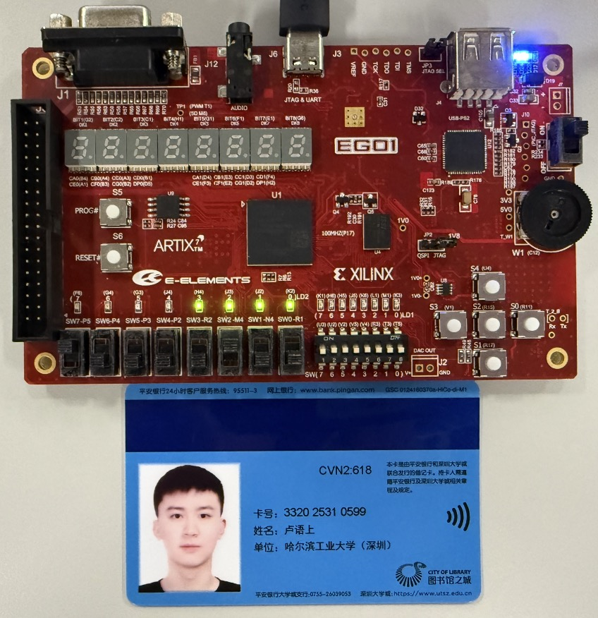
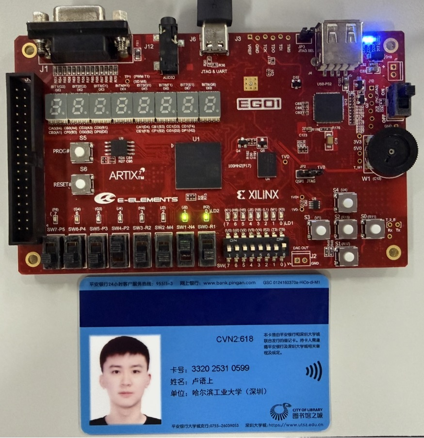
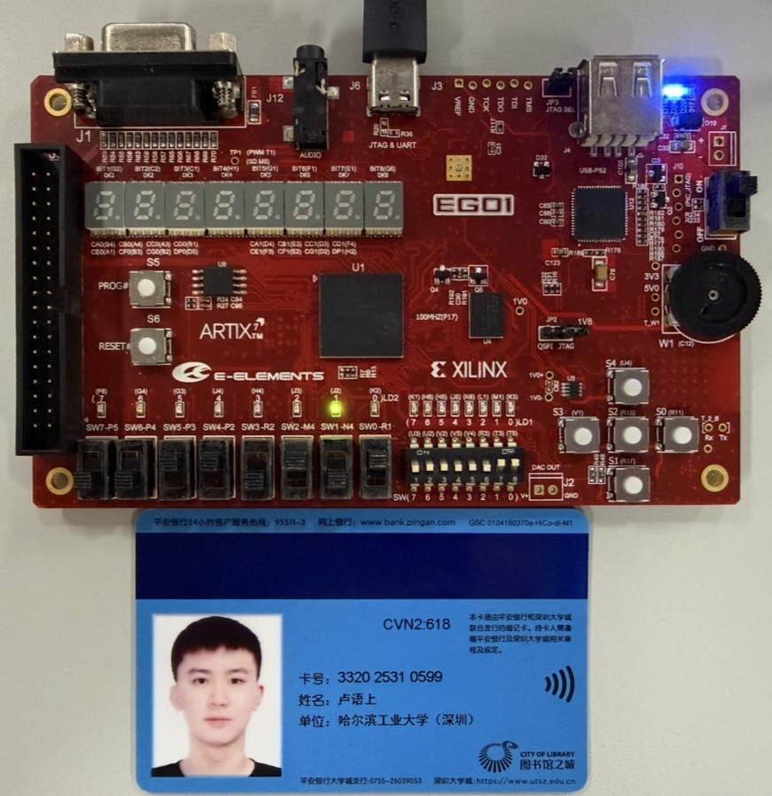
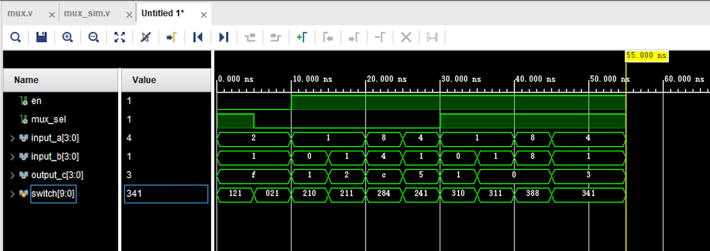
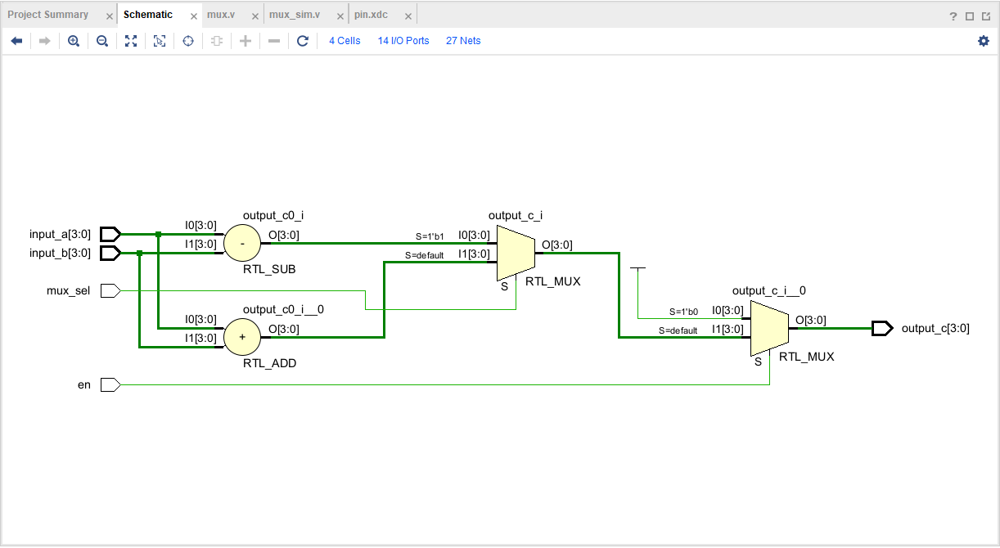
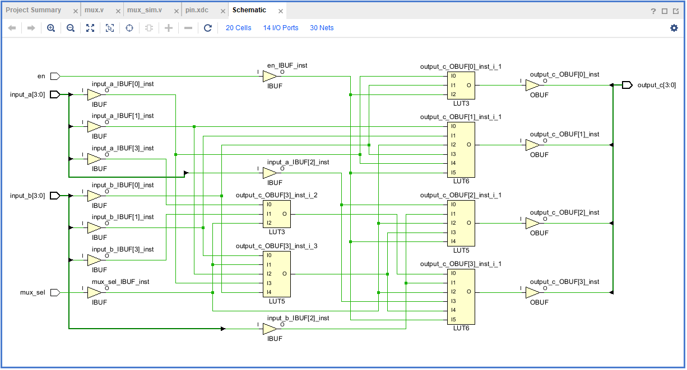

# 实验1：Vivado使用与组合电路

姓名：卢语上 学号：2025310599 班级：预计算机5班

一、多路复用器实验结果图
    - 将学生卡跟开发板放一起，拍照上板验证结果，照片中能看到学号和姓名
    - 包含使能无效、a+b、a-b三种测试情况，并分别文字说明输入取值、输出取值

使能无效：

输入：en = 0, mux_sel = 0, input_a = 0010, input_b = 0001；
输出：1111，符合预期。

a+b：

输入：en = 1, mux_sel = 0, input_a = 0010, input_b = 0001；
输出：0011，即3，符合预期。

a-b：

输入：en = 1, mux_sel = 1, input_a = 0101, input_b = 0011；
输出：0010，即2，符合预期。

二、多路复用器仿真波形截图和波形分析
    - 波形图缩放合适，截图信号名和波形，不要截图代码等无关的窗口，更不要用全屏截图
    - 截图和说明能正确、清晰体现所要求的功能，尤其对关键信号和信号的关键变化做说明分析

mux模块的仿真模块的仿真波形如下：

功能和信号说明：该模块完成多路复用器的功能，输入有使能en、选择信号mux_sel、数据input_a、input_b，输出为output_c。

波形分析说明：

- 初始en为0，改变mux_sel时，输出output_c恒为f。
- 10ns时en从0变成1，使能有效，mux_sel为0，为加法模式。例如20～25ns，8+4=c，即12，输出符合预期。
- 30ns时mux_sel变成1，为减法模式。例如30～35ns，1-0=1，输出符合预期。（40～45ns处在手抄仿真文件时抄错一处，导致输入和指导书不一致，但运算结果符合预期）

三、多路复用器电路图
2.1 RTL Analysis（RTL分析图）截图

2.2 Synthesis schematic（综合后电路图）截图
    注意不是Device图

