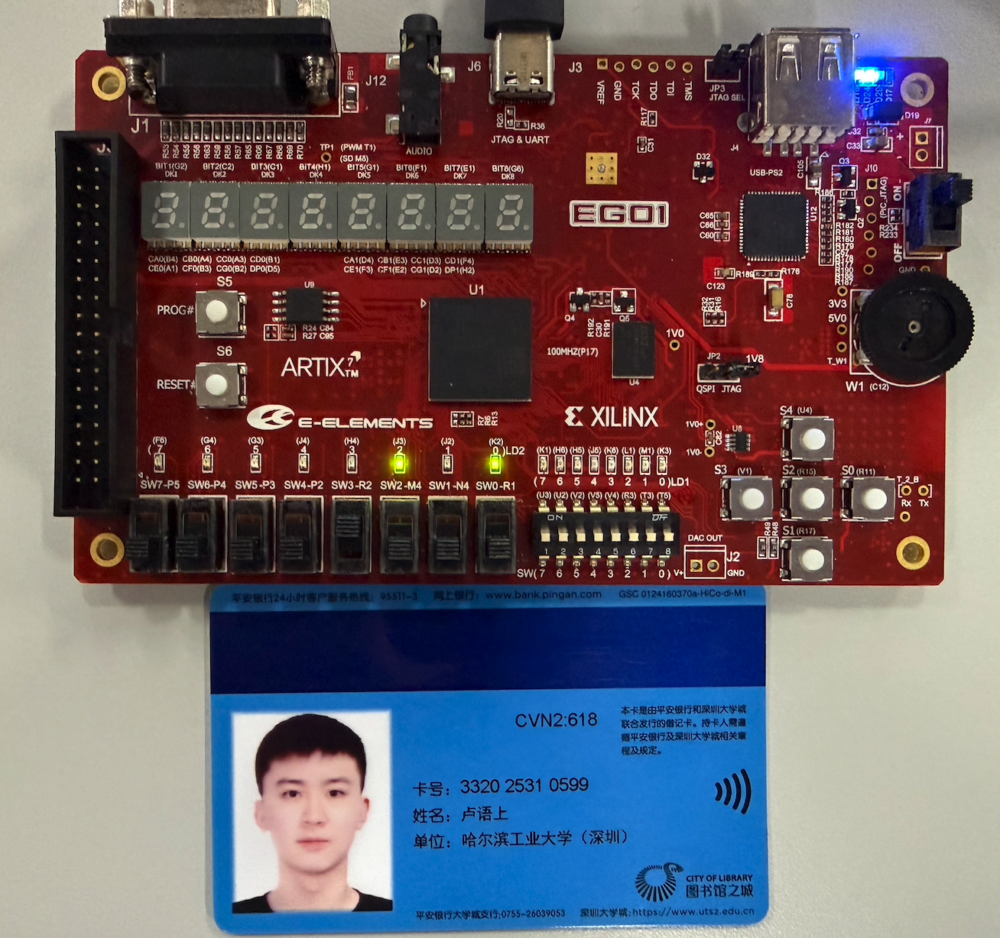
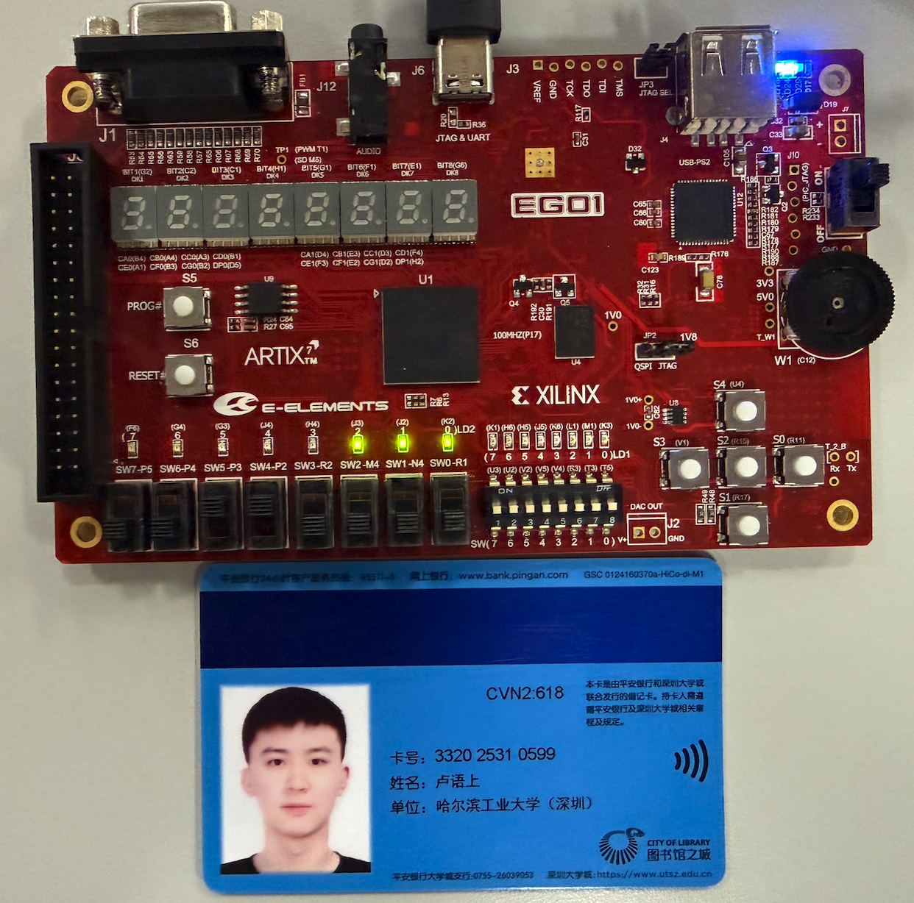
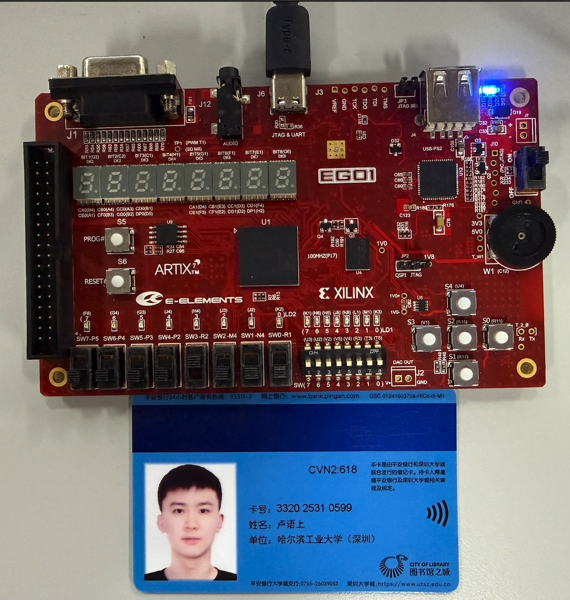
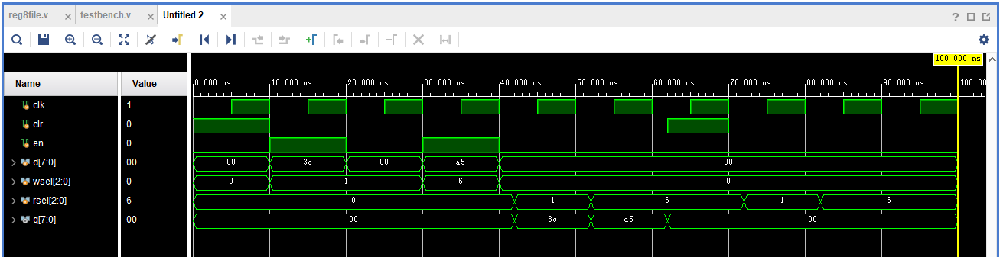
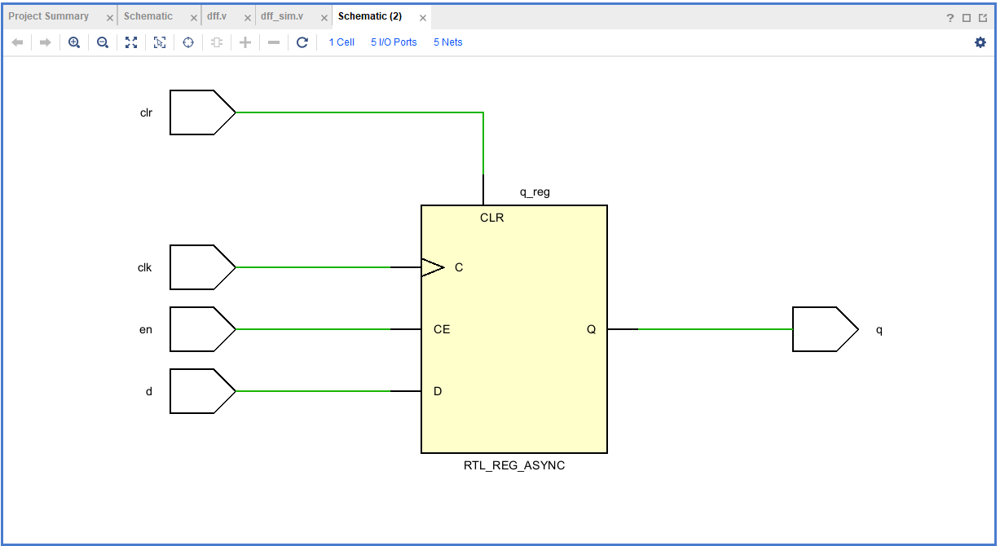
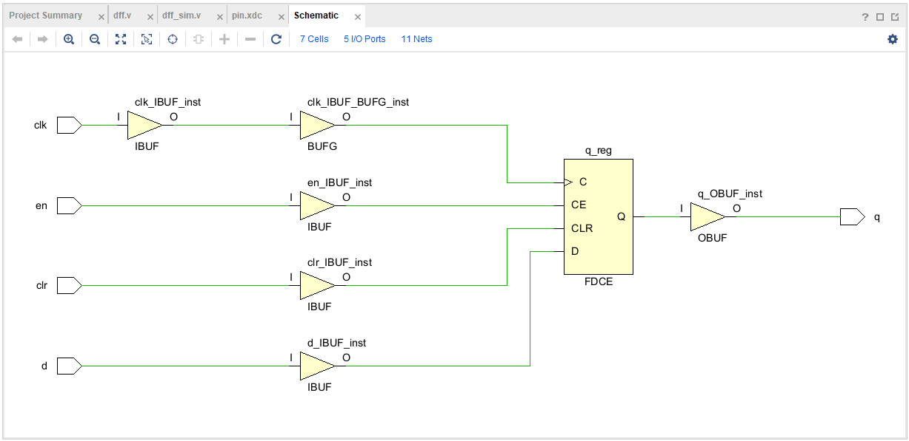
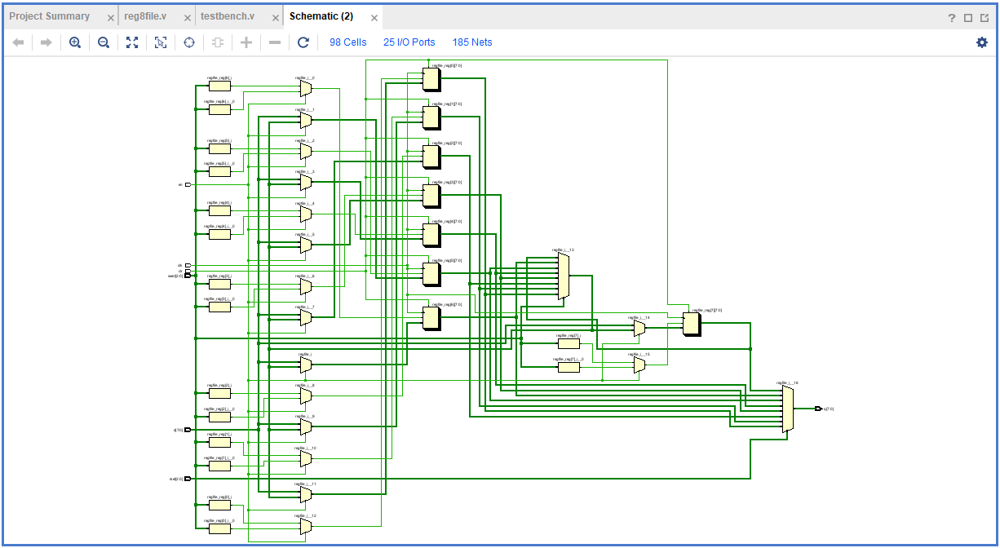
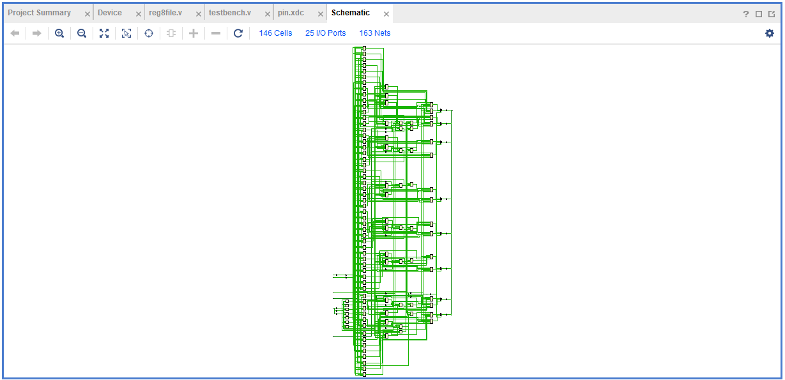

# 实验2：寄存器

姓名：卢语上 学号：2025310599 班级：预计算机5班

一、寄存器文件实验结果图

- 将学生卡跟开发板放一起，拍照上板验证结果，照片中能看到学号或姓名
- 按推荐步骤测试，体现2次读取和清零后再读取一次的结果即3张图，清零前两次读取不同的寄存器编号且输出不同，无需拍照写入和清零操作
- 先说明使能、写选择、读选择、数据输入、输出信号分别接的什么输入输出设备，再在每张图下文字说明输入取值、输出取值

信号连接：en接SW7，wsel[2:0]接SW2～SW0，rsel[2:0]接SW5～SW3，d[7:0]接DIP7～DIP0，q[7:0]接LD2_7～LD2_0；clr接按键S1，clk接板载100MHz时钟。

读取1号寄存器：
输入：en = 0，clr = 0，wsel = 000，rsel = 001，d = 00000000；
输出：q = 00000101，即5，LD2_2、LD2_0亮，与之前写入1号寄存器的数据一致。

读取6号寄存器：
输入：en = 0，clr = 0，wsel = 000，rsel = 110，d = 00000000；
输出：q = 00000111，即7，LD2_2、LD2_1、LD2_0亮，与之前写入6号寄存器的数据一致。

清零后读取1号寄存器：
按一下S1并松开，再将读地址切换回1号寄存器。输入：en = 0，clr = 0，wsel = 000，rsel = 001，d = 00000000；
输出：q = 00000000，LD2全部熄灭，原先存储的5已清零。

二、寄存器文件仿真波形截图和波形分析

- 波形图缩放合适，截图信号名和波形，不要截图代码等无关的窗口，更不要用全屏截图
- 截图和说明能正确、清晰体现所要求的功能，尤其对关键信号和信号的关键变化做说明分析。
- 以上两条波形截图说明为通用要求，后续实验不再赘述。

- 按复位、寄存器写入、读取以及异步清零顺序仿真和说明
- 要求写不同的数据到2个不同的寄存器，再从写入的2个寄存器读取

波形分析说明：

- 0～10ns，clr为1，寄存器文件处于复位状态，输出q为00。
- 10ns时解除复位并使能写入，wsel=1、d=3c，在15ns时钟上升沿将3c写入1号寄存器；30ns时wsel=6、d=a5，在35ns上升沿将a5写入6号寄存器。此时rsel始终为0，因此q仍为00。
- 40ns时en变为0，停止写入。42ns时rsel变为1，q立即变为3c；52ns时rsel变为6，q立即变为a5，均不等待时钟上升沿，体现异步读取。
- 62ns时clr变为1，q立即由a5变为00，不等待65ns的时钟上升沿，体现异步清零。
- 70ns时释放复位，72ns和82ns分别读取1号寄存器和6号寄存器，q均为00，说明两个已写入的寄存器均已清零。

三、电路图
2.1 D触发器的RTL Analysis和Synthesis schematic截图

RTL Analysis截图：

Synthesis schematic截图：

2.2 寄存器文件的RTL Analysis和Synthesis schematic截图
    寄存器文件Synthesis schematic图较复杂，只需整体截一张图，不用放大截多张

RTL Analysis截图：

Synthesis schematic截图：

