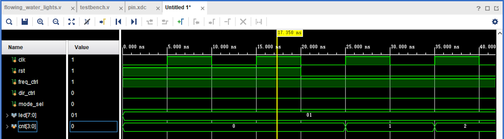
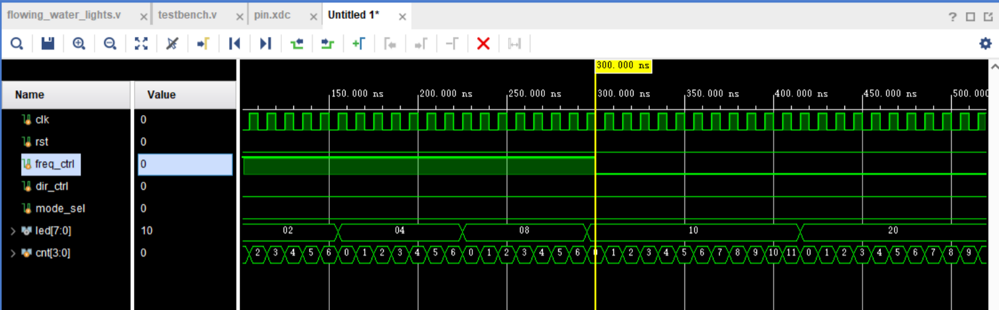
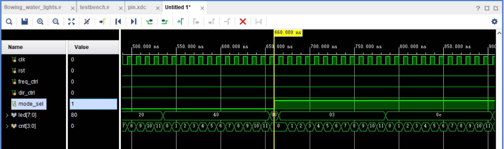

# 实验3：计数器

姓名：卢语上 学号：2025310599 班级：预计算机5班

一、计数器波形仿真截图和波形分析

- 根据需要可截多张波形图，需明确指出分析说明对应哪张仿真截图
- 按复位、频率切换、模式切换的顺序仿真和说明，频率、模式切换各体现一次，方向切换不用体现
- 不要将多位信号展开显示，计数cnt信号设置为无符号十进制（Unsigned Decimal）显示，其他多位宽信号默认进制显示
- 仿真时按以下要求调小计数值：频率切换波形图能完整体现计数器值cnt 从0-6和0-11的变化。

复位波形图：时钟周期为10 ns。0–20 ns内rst为1，计数器cnt保持为0，led为十六进制01，即只亮LED0。20 ns时rst变为0，释放复位；随后在25 ns、35 ns的时钟上升沿，cnt依次变为1、2，说明计数器恢复计数。由于尚未达到计数上限，led仍保持01。

频率切换波形图：rst保持为0，dir_ctrl和mode_sel均为0，流水灯处于向高位移位的单灯模式。300 ns前freq_ctrl为1，cnt按0、1、...、6、0循环，每7个时钟周期更新一次led，间隔为70 ns；图中led依次出现04、08、10。300 ns时freq_ctrl由1变为0，计数上限由6切换为11，cnt按0、1、…、11、0循环，每12个时钟周期更新一次led，间隔为120 ns。图中cnt在405 ns达到11，415 ns回到0，同时led由10变为20，表明频率切换生效，且无需再次复位。

模式切换波形图：freq_ctrl保持为0，计数上限为11，dir_ctrl保持为0。660 ns前mode_sel为0，led依次显示20、40、80，表示单灯向高位移动。660 ns时mode_sel由0变为1，在下一时钟上升沿665 ns，led初始化为03，即LED0和LED1同时点亮，cnt清零并重新计数。785 ns时cnt计满后回零，led由03变为0C，即点亮LED2和LED3，说明双灯模式每次向高位移动两位，更新间隔仍为120 ns。模式切换过程中rst始终为0，无需再次复位。

二、计数器最大值的计算
    时钟频率100MHz，给出流水灯20Hz频率对应的计数器变量cnt应达到的最大值的计算过程，cnt从0开始。

时钟频率为100 MHz，即每秒有100,000,000个时钟周期，时钟周期为1/100,000,000 s = 10 ns。流水灯以20 Hz更新时，每次更新的时间间隔为1/20 s = 0.05 s，因此需要的时钟周期数为N = 100,000,000 / 20 = 5,000,000。由于cnt从0开始计数，从0计到最大值共经历“最大值+1”个计数状态，所以计数器最大值为N−1 = 4,999,999。计数结束时产生一次移位使能，而非每半周期翻转一次方波，因此不需要再除以2。
