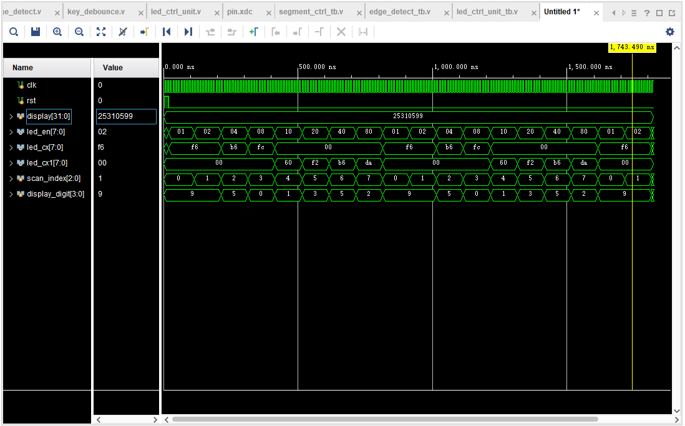
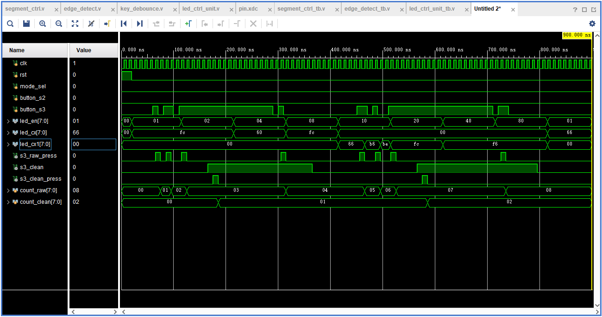
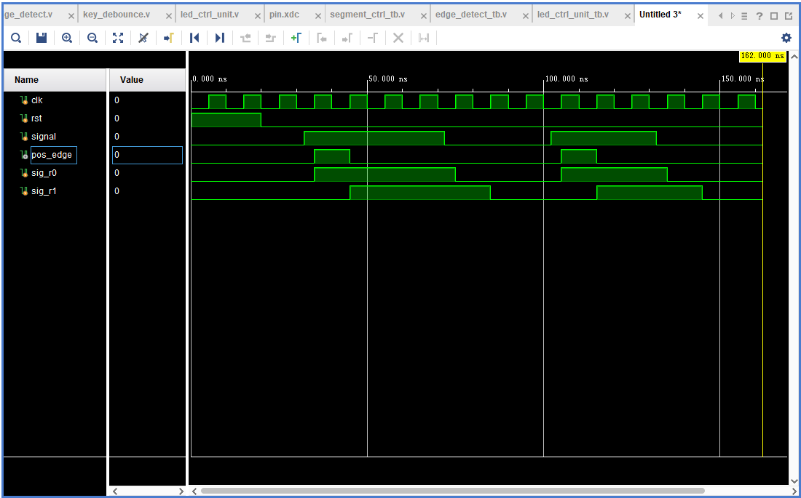
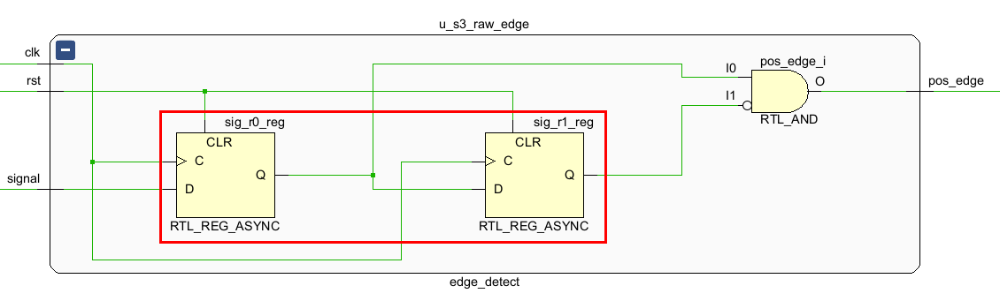

# 实验4：数码管控制器

姓名：卢语上 学号：2025310599 班级：预计算机5班

一、数码管控制器仿真波形截图和波形分析

- 根据需要可以截多张仿真波形图，需明确指出分析说明对应哪张仿真截图
- 按数码管轮询和按键消抖计数的顺序仿真和说明，其他功能不做仿真要求
- 数码管轮询：完整体现led_ctrl_unit模块8个数码管轮询过程位选信号、段选信号和个人学号后8位数据的变化
- 按键消抖计数：模拟一个带有抖动的按键波形输入，分析输出，并体现2次消抖计数
- 不要将多位信号展开显示，个人学号后8位数据设置为十六进制（Hexadecimal），其他多位宽信号默认进制

图中 `display` 保持为十六进制 `25310599`。复位释放后，`scan_index` 在 0～7 之间循环，`led_en` 依次为 `01、02、04、08、10、20、40、80`，每次仅选通一位。仿真中每位驻留 100 ns，一轮扫描为 800 ns，图中包含两轮以上扫描。扫描从最低四位开始，`display_digit` 依次为 `9、9、5、0、1、3、5、2`；前四位由 `led_cx` 输出段码 `F6、F6、B6、FC`，后四位由 `led_cx1` 输出 `60、F2、B6、DA`，未选中的一组段选为零。位选与段选对应，从左到右的显示内容为 `25310599`。

图中 `button_s3` 模拟了两次带按下、释放抖动的按键操作。未消抖通道因抖动产生多个上升沿脉冲，`count_raw` 最终由 `00` 增至 `08`。消抖通道要求同步后的输入连续稳定达到门限才更新 `s3_clean`，本次仿真门限为 4 个时钟周期。两次有效按下各产生一个 `s3_clean_press` 脉冲，使 `count_clean` 在约 185 ns、585 ns 分别增至 `01`、`02`；长按及释放抖动均未造成额外的消抖计数，符合每次按键只计数一次的预期。

二、两级寄存器级联的边沿检测仿真波形截图和分析

图中 `sig_r0` 在时钟上升沿采样 `signal`，`sig_r1` 比 `sig_r0` 延迟一个时钟周期，输出为 `pos_edge = sig_r0 & ~sig_r1`。输入在 32 ns 上升后，35 ns 时 `sig_r0` 为 1、`sig_r1` 仍为 0，输出脉冲；45 ns 时 `sig_r1` 变为 1，脉冲结束。第二次输入上升同样产生 105～115 ns 的脉冲。两次脉宽均为一个时钟周期（10 ns），输入持续为高电平及下降时不产生额外脉冲，实现了上升沿检测。

三、边沿检测RTL截图

- 需用红框准确标记二级寄存器级联的位置，若边沿检测单独模块实现，打开RTL图后点击该模块查看模块内部的RTL图。

