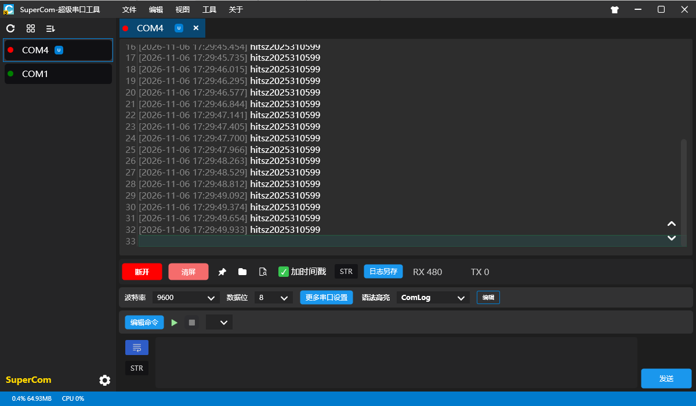
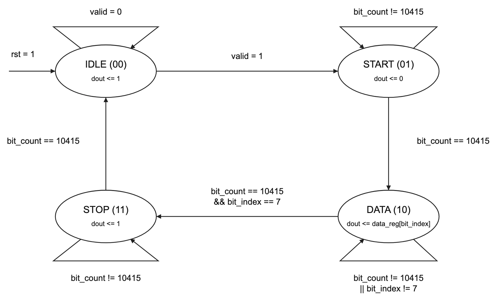
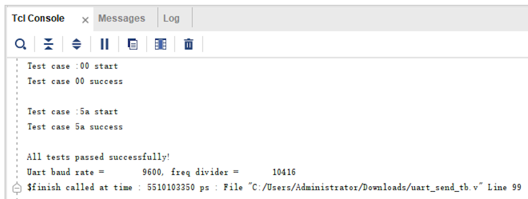
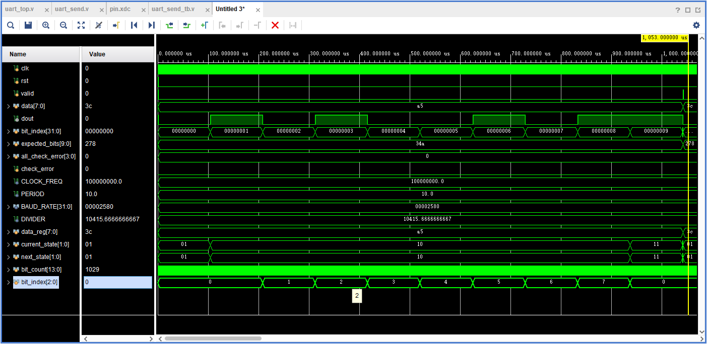
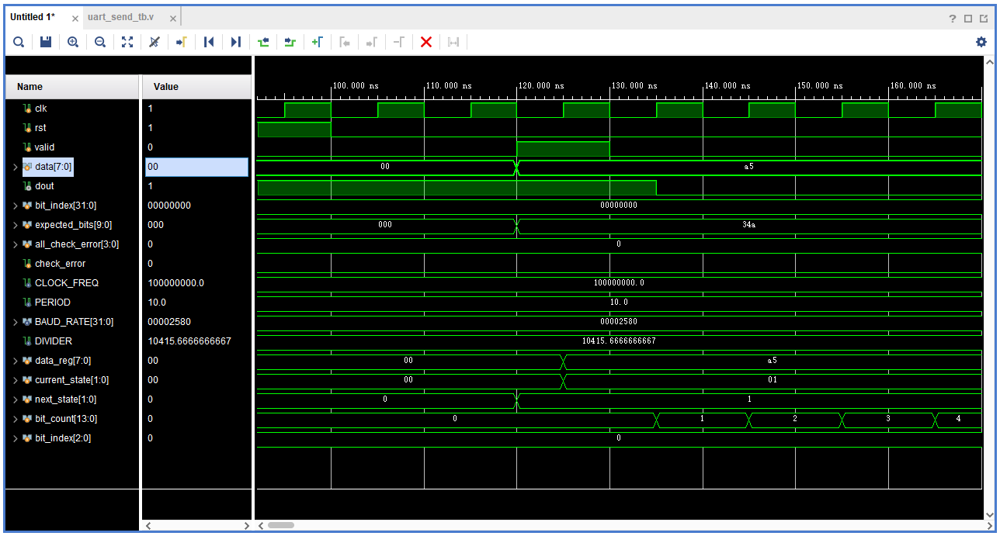
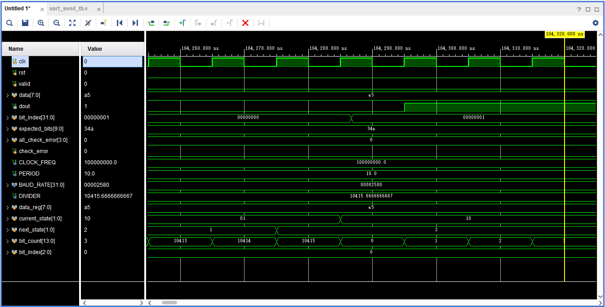

# 实验五：状态机

姓名：卢语上 学号：2025310599 班级：预计算机5班

一、串口软件接收到的数据截图
   请截图不要用手机拍照，需清晰的体现接收到的数据，不用放学生卡
   注意“hitsz20250101"只是示例数据，要替换为自己的学号。

图中连续多行均完整显示字符串“hitsz2025310599”，通过将串口软件分包超时调大到100ms解决字符串跨行显示问题。

按代码计数值计算，字符串内相邻字符的起始间隔为 2 ms；末字符与下一轮首字符的起始间隔为 252 ms，扣除一帧的发送时间后，字符串之间的空闲时间约为 250.9584 ms，满足不小于 0.2 s 的要求。串口截图中的行时间戳间隔约为 0.28 s，与设计的整串重复周期相符。

二、状态转移图
    - 与uart_send模块代码对应的状态转移图
    - 异常状况处理如STOP状态接收到低电平等无需考虑。
    - 要求清晰的电子版，工具不限，比如draw.io、ppt、飞书等，状态图的规范见后文。

发送模块采用三段式描述，分别实现状态寄存器、组合次态逻辑和时序输出逻辑。四个状态编码为 IDLE=00、START=01、DATA=10、STOP=11，转移过程如下：

- IDLE：输出空闲高电平。当 valid=1 时，在时钟上升沿锁存 data，并进入 START；否则保持空闲。
- START：发送低电平起始位。bit_count 从 0 计数到 10415 后进入 DATA，同时计数器归零。
- DATA：按低位到高位的顺序发送 data_reg[0] 至 data_reg[7]，每位持续 10416 个时钟周期。前七位结束后更新位索引并保持 DATA；最后一位结束后进入 STOP。
- STOP：发送高电平停止位，计满 10416 个时钟周期后返回 IDLE，完成一次发送。

图中的 rst=1 表示从任意状态均可异步复位到 IDLE，同时将 dout 置为 1，并清零数据寄存器和计数器。圆内的“dout <= …”表示时钟上升沿执行的非阻塞赋值规则：输出使用该沿更新前的现态和位索引，因此 dout 的相应变化比现态或位索引更新晚一个时钟周期，即 10 ns。发送期间使用锁存的 data_reg，外部 data 的变化不会改变正在发送的数据。

三、uart_send模块仿真波形截图和波形分析
    - 使用指导书提供的仿真文件uart_senf_tb.v跑仿真，仿真结束后Tcl Console显示测试通过的截图
    - 波形图和分析能正确清晰体现状态机输入、现态、次态、输出，
      覆盖一个完整数据帧(起始位+数据位+停止位)

使用 uart_send_tb.v 进行仿真。运行至结束后，Tcl Console 显示“All tests passed successfully!”，说明官方测试中的 A5、3C、FF、00、5A 五组用例均通过。仿真在 5510103350 ps，即约 5.51010335 ms 时结束。

上图展示第一个数据 A5 的完整发送过程。输入为 clk、rst、valid 和 data，current_state、next_state 分别表示现态与次态，dout 为串行输出。图中的 bit_index[31:0] 是 testbench 的校验索引，bit_index[2:0] 才是发送模块内部的 8 位数据索引。

A5 的二进制表示为 10100101，按低位先发的顺序，八个数据位依次为 1、0、1、0、0、1、0、1；加上低电平起始位和高电平停止位，构成 8N1 数据帧。波形中现态依次经历 START、DATA、STOP 并返回 IDLE，dout 的电平顺序与该数据帧一致。

时钟周期为 10 ns，每位保持 10416 拍，即 104.16 μs，完整十位数据帧持续 1.0416 ms。第一帧起始位从 135 ns 开始，数据位从 104295 ns 开始，停止位从 937575 ns 开始，完整帧于 1041735 ns 结束。

上图放大了开始发送的过程。100 ns 时复位解除；120 ns 时 valid 拉高、data 变为 A5，组合逻辑使 next_state 指向 START。125 ns 的时钟上升沿将 A5 锁存到 data_reg，并使 current_state 从 IDLE 变为 START。valid 在 130 ns 撤销，只持续一个时钟周期。由于 dout 采用时序输出，125 ns 时仍按更新前的 IDLE 输出高电平，到 135 ns 才拉低并开始发送起始位，体现了输出相对状态变化晚一拍的关系。

上图放大了起始位向数据位的转移。104275 ns 时 bit_count 到达 10415，组合逻辑将 next_state 置为 DATA；104285 ns 的上升沿使 current_state 从 START 变为 DATA，并将 bit_count 清零。此时 dout 仍按更新前的 START 输出 0；到 104295 ns 才输出 data_reg[0]=1。由起始位开始的 135 ns 到首个数据位开始的 104295 ns，相差 104160 ns，验证起始位完整维持了 10416 个时钟周期，没有因状态与输出的一拍偏移而缩短。
