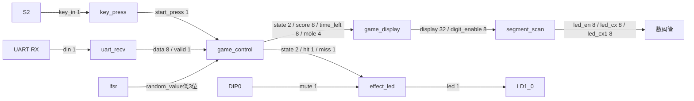
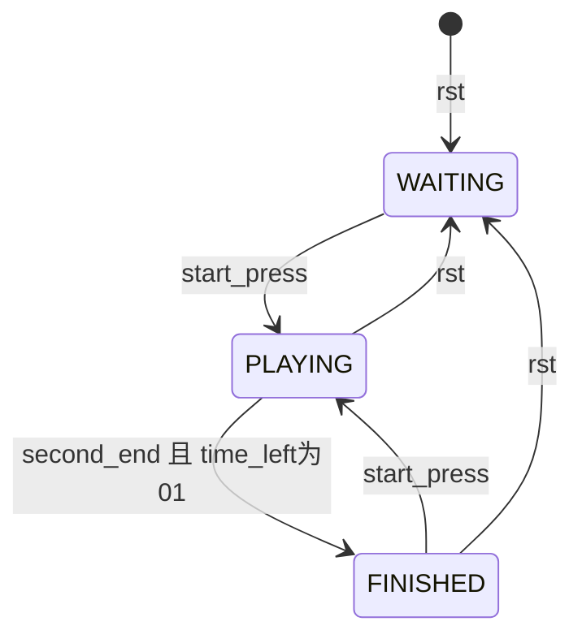

# 打地鼠设计说明

## 模块与数据流

设计顶层为 `top`，文件名为 `top.v`，内部只有连线、参数传递和模块例化。所有寄存器使用同一个 100 MHz 时钟；计时终点是使能条件，不作为新时钟。

各模块另接 `clk` 和高有效异步 `rst`，纯组合 `game_display` 除外。LFSR 输出 16 位，顶层只连接其中低三位给游戏模块。顶层共有七个子模块。

| 顶层接口 | 方向、位宽 | 硬件 |
| --- | --- | --- |
| clk | 输入 1 | P17，100 MHz |
| rst | 输入 1 | S0，R11，高有效 |
| button_s2 | 输入 1 | S2，R15，高有效 |
| mute | 输入 1 | DIP0，T5，上拨为 1 |
| uart_rx | 输入 1 | N5，FPGA 接收端 |
| effect_led | 输出 1 | LD1_0，K3，高电平亮 |
| led_en | 输出 8 | DK0 至 DK7，高有效 |
| led_cx | 输出 8 | DK0 至 DK3 的段选 |
| led_cx1 | 输出 8 | DK4 至 DK7 的段选 |

UART 接口约定为 `valid` 单周期脉冲和 `data[7:0]`；`start_press`、`hit`、`miss` 也均为单周期脉冲。`score` 与 `time_left` 是两位 packed BCD，不是普通八位二进制整数，波形应设 Hex 阅读，例如 `8'h20` 表示十进制 20。`mole` 是普通四位二进制数 1 至 8，0 代表无洞位。

## 三段式状态机

WAITING=0、PLAYING=1、FINISHED=2；未标注条件均保持原状态。非法状态下一拍回到待机并初始化数据。实现严格分为状态寄存器、组合次态逻辑、时序输出与数据通路三个 always 块。

待机或结束收到开始脉冲时，同时进入游戏、清零分数、装载 20 秒、清零秒内计数并采样洞位。游戏中开始脉冲被忽略。默认每秒精确计数 100,000,000 个时钟，从进入 PLAYING 到进入 FINISHED 共 2,000,000,000 拍；最后一个周期的结束条件优先于命中处理。

按秒递减 BCD：20→19→…→10→09→…→01→00。命中时 BCD 加一，09→10，99 饱和。饱和后仍然生成新洞位并反馈命中。每次 `recv_valid` 至多触发一次；连续多帧逐帧处理。串口的停止位中点产生有效字节，最终以游戏模块处理该有效脉冲的时钟沿判断是否超时。

错误的 1 至 8 触发 miss、保持分数和洞位；0、9、字母、回车、换行均忽略。待机和结束状态忽略串口字节，不排队。游戏开始瞬间仍在接收中的帧若在游戏期间完成，则按当时洞位判断；游戏不保存帧起始时的状态或洞位。

## 伪随机与输入

LFSR 使用非零种子 `16'hace1`，每拍左移，反馈为原 bit15、bit13、bit12、bit10 的异或，对应本原多项式 x^16+x^14+x^13+x^11+1。65535 拍循环，无全零状态。它在待机、游戏和结束时持续推进；开局或命中时采样低三位加一得到 1 至 8。复位后同样的输入时刻会重复同样序列，不是物理真随机，也不承诺绝对均匀或相邻洞位不同。

S2 先两级同步，连续 20 ms 不同于当前稳定值才更新；稳定按下产生一次脉冲，稳定松开后才能再次触发。静音使用两级同步，约两拍后生效，未另做机械消抖；短暂静音抖动不影响计分和计时。UART 输入也经两级同步，检测起始位、中点采样、LSB 优先，停止位为低时丢弃该字节。

## 显示与反馈

显示数据拼接为 `{score, time_left, 12'h000, mole}`；游戏位使能为 `8'hf1`，待机、结束为 `8'hf0`。复位期间扫描模块直接关闭段选和位选。扫描每位 1 ms、完整轮询 8 ms；被禁用的位置仍占扫描时隙，但不发光。两组段选独立，非选中组输出全零。

反馈模块按当前状态选择背景或事件频率。命中、错误事件在接收 hit/miss 脉冲后装载半秒倒计时；新事件覆盖旧事件并重新启动波形。结束状态优先清除事件，结束提示连续计时三秒，然后保持灭灯；重新开始立即取消结束提示。静音仅屏蔽最终输出，内部计数与方波相位照常推进，取消静音不重放已到期反馈。

频率通过半周期计数实现，待机/游戏/命中/错误/结束分别为 `CLK_HZ/2`、`/4`、`/16`、`/8`、`/6` 拍翻转。默认 3 Hz 因整数除法有极小量化误差，其他频率整除。状态或事件改变时从亮相位重新开始，边界存在一个时钟量级的同步处理延迟。

## 参数与独立工程

`CLK_HZ=100000000` 同时决定一秒和反馈计数；`BIT_CYCLES=10416`、`DEBOUNCE_CYCLES=2000000`、`SCAN_CYCLES=100000` 分别控制串口位宽、消抖、单个扫描时隙。仿真覆盖为 1000、16、4、4，时钟仍为 10 ns，即仿真一“秒”为 10 微秒，UART 位宽为 160 ns。

参数只用于默认硬件与加速仿真，不承诺任意取值：CLK_HZ 至少 16 且三倍不超过有符号 32 位整数；UART 位计数沿用 14 位，BIT_CYCLES 取 4 至 16384 的偶数；消抖计数沿用 21 位，取 1 至 2097152；扫描计数沿用 17 位，取 1 至 131072。game_control 的秒计数按参数自动确定宽度。实际板卡须使用默认参数，不能把 testbench 的参数带入综合顶层。

key_press、uart_recv、segment_scan 是从基础题复制的独立副本；本工程不跨目录引用基础题源码，不包含 UART 发送功能。必做题的学号发送仍在原独立工程演示。XDC 保留 create_clock，未添加掩盖问题的全局 false path。
